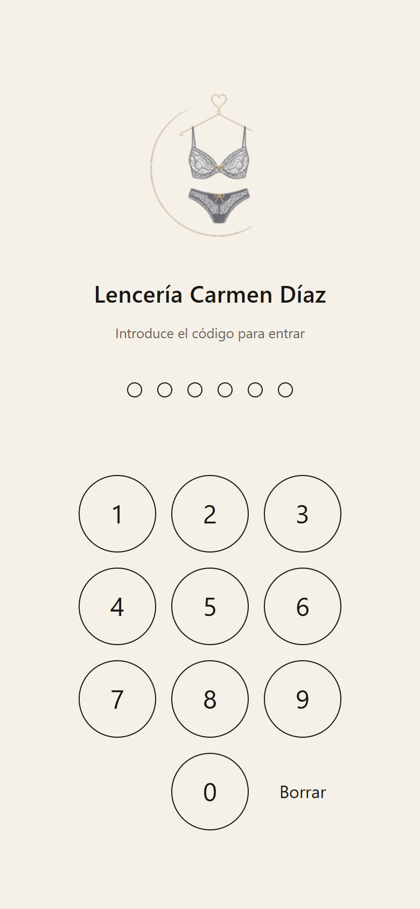
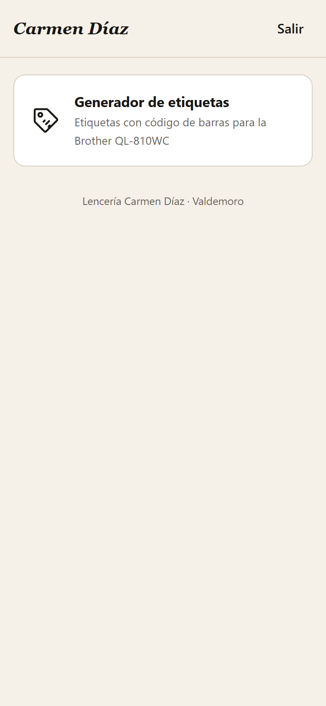
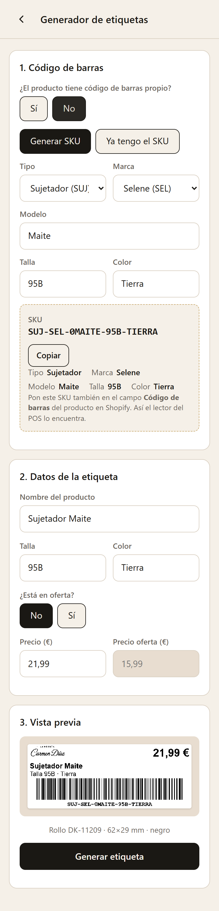
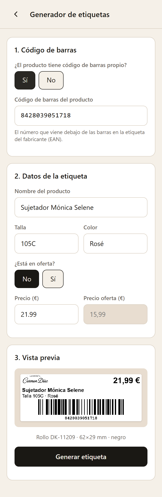
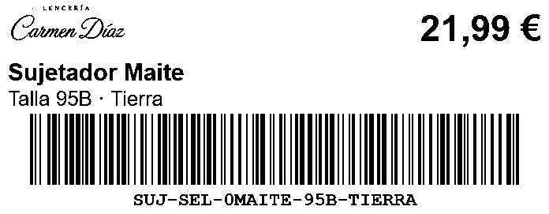
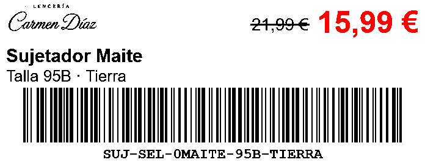

# Carmen Díaz · Herramientas

App para el día a día de **Lencería Carmen Díaz** (Valdemoro). Complementa a Shopify y Shopify POS con herramientas propias. Se abre desde el móvil o la tablet como una app más, y funciona también sin conexión.

Herramientas:

- **Generador de etiquetas** para la impresora Brother QL-810WC.

---

## 1. Instalarla en el móvil

1. Abre el enlace de la app en **Chrome** (Android) o en **Safari/Chrome** (iPhone/iPad).
2. Android: menú **⋮** → **Añadir a pantalla de inicio** → **Instalar**.
   iPhone/iPad: botón **Compartir** → **Añadir a pantalla de inicio**.
3. A partir de ahí se abre desde el icono de la percha, como cualquier app.

## 2. Entrar

Escribe el **código de 6 cifras**. El móvil lo recuerda durante 30 días. Para cerrar antes, pulsa **Salir** en la pantalla de inicio.

 

## 3. Hacer una etiqueta

### Paso 1 · ¿El producto tiene código de barras propio?

- **Sí** (lo normal: la etiqueta del fabricante trae un número de 13 cifras). Escribe ese número. La app avisa si falta o sobra alguna cifra.
- **No**. La app crea el código a partir del **SKU**:
  - **Generar SKU**: elige tipo y marca, y escribe modelo, talla y color. El SKU sale solo, por ejemplo `SUJ-SEL-0MAITE-95B-TIERRA`.
  - **Ya tengo el SKU**: escríbelo y la app te dice qué significa cada parte.

> **Importante:** si el producto no tenía código propio, copia el SKU (botón **Copiar**) y pégalo en el campo **Código de barras** del producto en Shopify. Si no lo haces, el lector del POS no lo encontrará.

 

### Paso 2 · Datos de la etiqueta

Nombre, talla, color y precio. Al generar el SKU se rellenan solos, pero puedes cambiarlos.

**Oferta:** marca **Sí** y escribe el precio de oferta. El precio normal pasa a ser el "precio antes" y sale tachado; el nuevo sale **grande en rojo**.

### Paso 3 · Vista previa y generar

La vista previa es exactamente lo que se imprime. Debajo aparece **qué rollo poner**:

| Etiqueta | Rollo | Colores |
| --- | --- | --- |
| Normal | **DK-11209** (62 × 29 mm, troquelada) | Negro |
| Oferta | **DK-22251** (62 mm continuo) | Negro y rojo |

Pulsa **Generar etiqueta** y en el menú de compartir elige **iPrint&Label**.

| Normal | Oferta |
| --- | --- |
|  |  |

## 4. Imprimir con iPrint&Label

Antes de nada, el móvil y la impresora tienen que estar en la **misma wifi** de la tienda. La primera vez, abre iPrint&Label y elige la impresora **QL-810W**.

1. En la app de herramientas pulsa **Generar etiqueta**.
2. En el menú de compartir elige **iPrint&Label**. En iPhone puede aparecer como "Abrir en iPrint&Label"; si no sale, desliza la fila de apps → **Más**.
3. En iPrint&Label comprueba que:
   - el rollo detectado coincide con el que pide la app (DK-11209 o DK-22251);
   - la imagen **no se escala**: tamaño original o 100 %, sin "ajustar";
   - con el rollo continuo DK-22251, el largo es de **29 mm**.
4. Elige el número de **copias** e imprime.

> **Pendiente de confirmar con la impresora real.** Hay que comprobar estos puntos en la primera prueba y corregir esta guía:
> - Si iPrint&Label imprime la imagen al 100 % o la reescala. La imagen mide 696 × 271 px, que es el área de impresión exacta a 300 ppp.
> - Si con el rollo DK-22251 el precio sale en **rojo** o en negro.
> - Si el lector de pistola y la **cámara** del POS leen bien el SKU (25 caracteres, barras de 0,17 mm).

### Problemas comunes

| Pasa esto | Prueba esto |
| --- | --- |
| No aparece iPrint&Label al compartir | Instálala desde Play Store / App Store y ábrela una vez. |
| No encuentra la impresora | Misma wifi; reinicia la impresora; en iPrint&Label → Ajustes → Impresora. |
| Sale más pequeña o con margen | Desactiva "ajustar al tamaño" en iPrint&Label. |
| El rojo sale en negro | Comprueba que el rollo puesto es el DK-22251. |
| El POS no encuentra el producto | Revisa que el número de la etiqueta esté en "Código de barras" en Shopify. |

## 5. Tipos y marcas

En el desplegable de tipo o marca elige **Otro…**, escribe el nombre y la app propone un código de 3 letras. Se queda guardado **en ese móvil**.

Para añadirlo para todos, edita en GitHub [`data/tipos.json`](data/tipos.json) o [`data/marcas.json`](data/marcas.json): abre el archivo, pulsa el lápiz y añade una línea como `"BOD": "Body",`.

## 6. Reglas del SKU

`TIPO-MARCA-MODELO-TALLA-COLOR` → `SUJ-SEL-0MAITE-95B-TIERRA`

| Parte | Letras | Si falta | Si sobra |
| --- | --- | --- | --- |
| Tipo | 3 | — | — |
| Marca | 3 | — | — |
| Modelo | 6 | ceros delante (`MAITE` → `0MAITE`) | se corta el final (`ANTONELA` → `ANTONE`) |
| Talla | 3 | ceros delante (`XL` → `0XL`) | se queda el final (`100B` → `00B`) |
| Color | 6 | ceros delante (`ROSE` → `00ROSE`) | se corta el final (`AZUL ELÉCTRICO` → `AZULEL`) |

Se quitan tildes y espacios. Los SKU antiguos (`SUJ-SEL-BLA-90C-BLA`) siguen valiendo: la app avisa, pero los imprime. Un SKU nuevo nunca coincide con uno antiguo, porque tienen longitudes distintas.

---

## Para quien mantiene la app

- Sin dependencias ni build: HTML, CSS y JavaScript que GitHub Pages sirve tal cual.
- `node scripts/serve.js` → http://localhost:8080 para probar en local.
- `npm test` → tests del Code 128 y del SKU.
- `PIN=xxxxxx node scripts/screenshots.js` (con el servidor arrancado) → prueba de extremo a extremo en Edge sin ventana y capturas en `docs/capturas/`.
- Cambiar el PIN: `node scripts/pin-hash.js 123456` y pega el resultado en [`app/js/config.js`](app/js/config.js).
- Regenerar logo e iconos: `powershell -File scripts/build-assets.ps1 -Logo "ruta\Logo Tienda.png"`.
- Añadir una herramienta: ver [`app/js/tools.js`](app/js/tools.js).
- Decisiones de diseño: [`docs/decisiones.md`](docs/decisiones.md).

**El repo es público:** no subas nunca CSV de Shopify, precios de coste, datos de clientas ni claves. El `.gitignore` ya bloquea los `.csv` y los `.env`.
